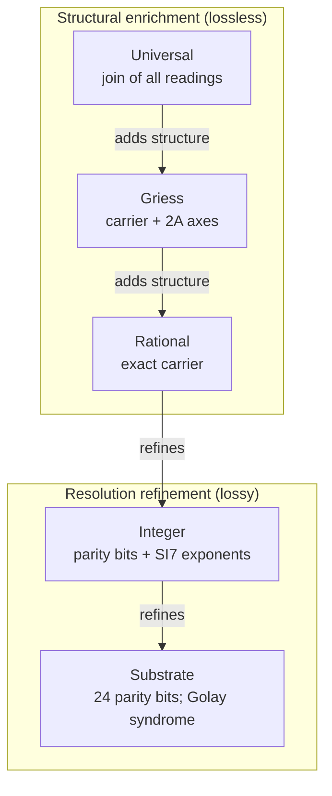
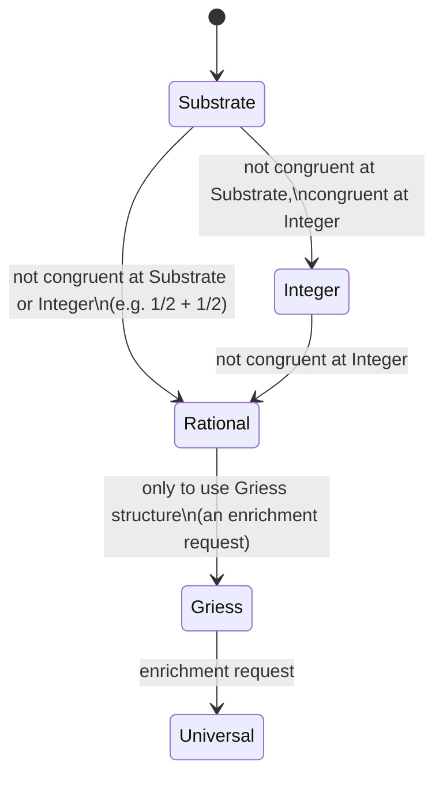
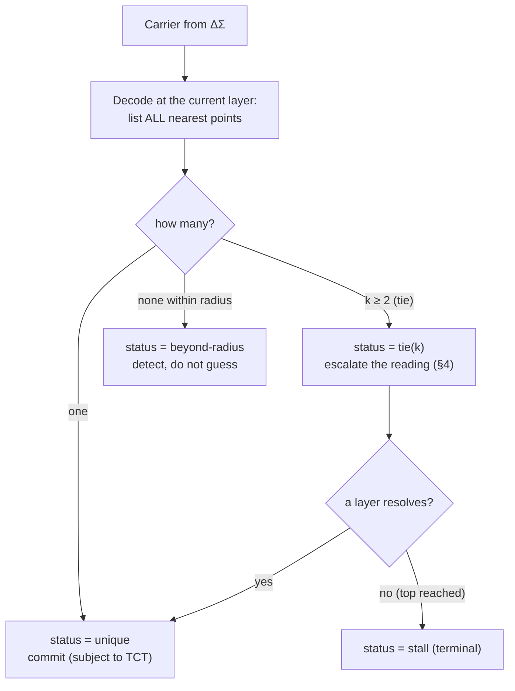

# The Geometric Language Machine: Escalation Boundaries, Layers, and Tie-Aware Snapping

**Current edition (Round 46).** This document replaces the exploratory sketch of the same name. It
keeps the sketch's questions and section numbering, and states only what is now known. Every claim
carries an evidence tag. The original sketch is kept unchanged as
`GLM_Escalation_Boundaries_Exploration_ORIGINAL.md`. Appendix A lists every point where the sketch
and this edition differ.

**Evidence tags**

| tag | meaning |
|---|---|
| **FORMAL** | proved in Lean 4 in the package `RequestProject/GLM/` (standard axioms only) |
| **CERT** | a finite Lean certificate (`native_decide`) |
| **CLASSICAL** | a published theorem, cited and not re-proved here |
| **REPORTED** | stated by the shipped GLM repository (`glm_repo.zip`), not re-checked |
| **EXACT** | an exact computation in the standard-library engine `glm_engine/hypothesis_engine.py` (not a Lean proof) |
| **PROPOSAL** | a design choice; nothing proves or refutes it |

The Lean names below are of the form `File.declaration`:
* the escalation files are in `RequestProject/GLM/Escalation/`;
* the engine contracts are in `RequestProject/GLM/HypothesisEngine/`;
* the Rule 30 results are in `RequestProject/GLM/Rule30/`.

**Status of the Rule 30 prize problems:** all three are **open**. Nothing in this document, the
engine or the Lean package settles them.

---

## 0. Summary of verdicts

| Question from the sketch | Answer now | Evidence |
|---|---|---|
| Should the layer be part of the state? | Yes: one tick maps (carrier, layer) to (carrier, layer) | FORMAL `MasterStep` (`Machine.step`) |
| Is "TCT failure ⇒ keep the old state" a workable semantics? | No: with a fixed target the run deadlocks for ever | FORMAL `Machine.step_of_reject`, `Machine.iterate_of_reject` |
| Is the snap the only place the layer changes? | Yes, if ΔΣ and the gate preserve the layer | FORMAL `Machine.layer_preserved_of_snap`, `layer_preserved_iterate` |
| Are the five layers the residue filters mod 2, 4, 8, 144, 256? | No. Residue views refine exactly by divisibility; 8 ∣ 144 but 144 ∤ 256; no residue view refines the lossless Rational layer | FORMAL `LayerStack.residue_refines_iff`, `residue_144_refines_8`, `residue_256_not_refines_144`, `residue_not_refines_identity` |
| Do the five filters resolve the half-unit sum 1/2 + 1/2? | No floor-residue filter does, for any modulus ≥ 2 | FORMAL `LayerStack.floorResidue_add_not_congruent`, `MasterStep.five_floor_filters_fail` |
| Is "graded escalation" correct? | Yes, as "the least layer at or above the current one that resolves" | FORMAL `MasterStep.escalate_spec`, `escalate_eq_none_iff`, `escalate_isSome_of_top` |
| Does complete syndrome decoding make the snap stable? | It makes it deterministic, not stable: no choice of coset leaders is continuous | FORMAL `MasterStep.no_continuous_leader` |
| Do residues mod 8, 144, 256 select deep-hole types? | No: in Conway's integer coordinates they are the same coset, for every modulus divisible by 8 | FORMAL `LeechResidue.leechZ_add_smul`, `leechZ_sub_of_modEq` |
| Are there 23 deep-hole types? | Yes (CLASSICAL). The ADE side is checked: exactly 23 root systems; the sketch listed 22 and missed E₆⁴ | FORMAL `Niemeier.rank_cox_classification`, `niemeier23_diff_sketch22` |
| Does the layer give a run a direction (the owner's arrow)? | Yes, if the snap only escalates: the layer is non-decreasing and eventually constant | FORMAL `MasterStep.layer_monotone`, `layer_eventually_const` |

---

## 1. Introduction

The GLM Technical Specification gives four things:
* a Master Operator Equation;
* a five-layer hierarchy (Substrate ≺ Integer ≺ Rational ≺ Griess ≺ Universal);
* a congruence predicate;
* a worked example of addition breaking down at the substrate.

The sketch found three places where the spec is loose: the composition order of the equation, what
the side-conditions mean, and how `snap_Λ₂₄` resolves ties. All three are real.

The sketch's central thesis was that the "5-bit modular escapement filters" (residues mod 2, 4, 8,
144, 256) and complete syndrome decoding at the deep holes are two views of one structure. That
thesis is **refuted**, for three reasons:

1. the five moduli do not form a refinement chain (§3);
2. they do not resolve the sketch's own example (§4);
3. three of them carry the same information about the Leech lattice (§5).

What survives, and is now proved, is:
* the layer is part of the state;
* escalation means "the least layer that resolves";
* the snap is where ties are detected and the layer is chosen;
* if the snap only escalates, the run has an arrow.

The escalation boundary is real. A run crosses it by changing what a layer **reads**, not by
changing a modulus.

---

## 2. The Master Equation

The spec writes one tick as

  Ψ_{n+1} = (R_gate ∘ snap_Λ₂₄[ΔΣ(x_n*)]) Ψ_n, subject to TCT ≡ VERIFIED and L_k ∈ ℚ²⁴.

**Reading.**
* ΔΣ_{x*} is the modulator's update rule on the carrier, with target x*.
* One tick is R_gate ∘ snap ∘ ΔΣ_{x*}.
* The carrier lives in ℚ²⁴, so an irrational target x* is never *held* by the carrier. The
  modulator produces rational carriers whose running average tends to x*. "Irrational" describes
  the target of the process, not any state. (Definition.)

### 2.1 The unified step

  ⟨Ψ_{n+1}, k_{n+1}⟩ = let Ψ̂ = ΔΣ_{x*}(Ψ_n); let ⟨Ψ̄, k'⟩ = snap(Ψ̂, k_n) in
            if TCT(Ψ_n, Ψ̂, Ψ̄) then ⟨R_gate(Ψ̄), k'⟩ else REJECT(Ψ_n, k_n).

This is `Machine.step` in `MasterStep.lean` (FORMAL definitions). The structure `Machine C K` has
four fields: `modulate`, `snap : C → K → C × K`, `gate` and `tct`.

**What REJECT must not be.** Suppose a rejected step leaves the state unchanged. Then, with a fixed
target, a rejected state is rejected on every later tick, and the run never moves again (FORMAL
`Machine.step_of_reject`, `Machine.iterate_of_reject`).

**Recommended semantics (PROPOSAL):**
* on rejection, escalate the layer and retry;
* at the top layer, report a terminal **stall**.

### 2.2 What the unified step guarantees

* A trajectory is a sequence of (carrier, layer) pairs. (Definition.)
* If the snap never changes the layer, no tick does (FORMAL `Machine.layer_preserved_of_snap`,
  `Machine.layer_preserved_iterate`).
* If the snap ignores the incoming layer, two accepted ticks from the same carrier land on the
  same layer (FORMAL `Machine.layer_of_input`).

---

## 3. The five layers

Here L' ≺ L means "every distinction made by L is also made by L'" (`LayerStack.View.Refines`).

### 3.1 What each layer reads

The shipped GLM assigns layers by what each layer reads (`LayerChain.lean` in `glm_repo.zip`,
REPORTED). The stack is cumulative: each layer keeps the reading of the layer below.

| Layer | Two carriers look the same when … | Lossless? |
|---|---|---|
| Substrate | their 24 parity bits ⌊cᵢ⌋ mod 2 agree | no |
| Integer | their parity bits **and** their seven SI7 exponents agree | no |
| Rational | their exact rational coordinates agree | yes |
| Griess | carrier **and** 2A axes agree | yes |
| Universal | every lower reading agrees | yes |

The Substrate's error-correcting structure is the extended Golay code: 24 bits, 12-bit syndrome,
4096 cosets (§5.2).

### 3.2 Residue filters are not the layers (FORMAL, `LayerStack.lean`)

* The residue view mod m' refines the residue view mod m **iff m ∣ m'** (`residue_refines_iff`).
* 2 ∣ 4 ∣ 8, and also 8 ∣ 144 (144 = 8·18), so mod 144 refines mod 8 (`eight_dvd_144`,
  `residue_144_refines_8`).
* 144 ∤ 256, so mod 256 does not refine mod 144 (`residue_256_not_refines_144`). Their common
  refinement is mod lcm(144, 256) = 2304 (`residue_pair_indist_iff`, `lcm_144_256`).
* A view refines the identity only if it is injective (`View.refines_identity_iff`). No residue
  view is injective (`residue_not_refines_identity`). So no residue layer can sit above the
  lossless Rational layer.

### 3.3 Why this order

* **Substrate ≺ Integer ≺ Rational** is *resolution refinement*: each reading contains the
  previous one and adds distinctions.
* **Rational ≺ Griess ≺ Universal** is *structural enrichment*. These layers are already
  lossless, so they add operations and observables, not distinctions.
* The GLM's register audit agrees: 1,040 entries resolve into 415 → 544 → 757 → 757 → 757
  classes, and 757 is the number of distinct carriers (REPORTED).

### 3.4 What each layer can compute

An operation descends to a layer iff it is congruent there (GLM `descends_iff_congruent`,
REPORTED). In this package the predicate is `View.Congruent`. Every operation is congruent at a
lossless layer (FORMAL `View.congruent_of_injective`).

| Layer | Descends | Fails |
|---|---|---|
| Substrate | XOR / AND on parity bits | ℚ-addition (1/2 + 1/2); one Rule 30 step on rows (FORMAL `Rule30Parity.step_not_congruent_parity`) |
| Integer | what parity bits and SI7 exponents determine | ℚ-addition in general |
| Rational, Griess, Universal | every operation on ℚ²⁴ (lossless) | — |

A ΔΣ run that tracks √2 is a process on rational carriers, so it lives at the Rational layer. The
Griess layer adds structure; it does not add the ability to hold irrationals.

---

## 4. Escalation: from binary to graded

**Trigger.** Escalate when two carriers are indistinguishable at L_k but the operation gives
results that are distinguishable there.

### 4.1 Graded escalation (FORMAL, `MasterStep.lean`)

  escalate(cong, k) = the least layer j ≥ k at which `cong j` holds, if there is one.

* `escalate_spec`: the layer returned resolves, and no layer between k and it does.
* `escalate_eq_none_iff`: escalation fails exactly when no layer at or above k resolves.
* `escalate_isSome_of_top`: if the top layer resolves, escalation always succeeds. A lossless top
  layer always resolves.
* Skipping layers is legitimate: the result is simply this minimum.

### 4.2 The half-unit case

| reading | 1/2 + 1/2 = 1 | verdict |
|---|---|---|
| ⌊q⌋ mod 2 | 0 + 0 = 0, but ⌊1⌋ mod 2 = 1 | fails |
| ⌊q⌋ mod m, any m ≥ 2 | floor does not commute with addition | fails (FORMAL `floorResidue_add_not_congruent`) |
| the five filters 2, 4, 8, 144, 256 | — | all fail (FORMAL `five_floor_filters_fail`) |
| ⌊4q⌋ mod 4 (a different, scaled reading) | 2 + 2 ≡ 0 = ⌊4·1⌋ mod 4 | consistent on this example (FORMAL `scaled_four_half_consistent`) |
| exact rationals (Rational layer) | lossless | resolves |

So escalation from the Substrate on the five-filter stack returns *none*. On the shipped stack it
returns the Rational layer: the Integer layer does not resolve, and the Rational layer is the least
one that does.

The sketch also stated that every failure escalates to a resolving layer above. On its own
five-filter stack this is **false** (FORMAL `graded_escalation_claim_false`). The correct
statement is `escalate_isSome_of_top`.

**Congruence is not monotone under refinement.** A coarse layer can be congruent where a finer one
is not (FORMAL `LayerStack.congruent_not_monotone`). Each layer must therefore be tested on its own,
which is exactly what `escalate` does.

### 4.3 Escalation flow

---

## 5. Snapping at ties: deep holes and syndromes

### 5.1 The deep holes of Λ₂₄ (CLASSICAL)

These are stated at the scale where the minimal norm is 4.
* Λ₂₄ is the unique even unimodular lattice in dimension 24 with no roots.
* It has 196,560 minimal vectors, and its covering radius is √2.
* Its deep holes fall into **23 types** under its automorphism group. These correspond one-to-one
  to the 23 Niemeier lattices *with roots*. A hole's type is read from the extended Dynkin diagram
  of its nearest lattice points (Conway–Parker–Sloane).
* Λ₂₄ itself has no roots and corresponds to no hole. Its shallow holes are a separate, larger
  classification, which is not checked here.

The root system of a Niemeier lattice with roots is an ADE system of rank 24 whose components all
have the same Coxeter number h. Exactly 23 such systems exist (FORMAL
`Niemeier.rank_cox_classification`, `niemeier23_card`, `niemeier23_nodup`):

| h | root system(s) | h | root system(s) |
|---|---|---|---|
| 2 | A₁²⁴ | 13 | A₁₂² |
| 3 | A₂¹² | 14 | D₈³ |
| 4 | A₃⁸ | 16 | A₁₅ D₉ |
| 5 | A₄⁶ | 18 | A₁₇ E₇, D₁₀ E₇² |
| 6 | A₅⁴ D₄, D₄⁶ | 22 | D₁₂² |
| 7 | A₆⁴ | 25 | A₂₄ |
| 8 | A₇² D₅² | 30 | D₁₆ E₈, E₈³ |
| 9 | A₈³ | 46 | D₂₄ |
| 10 | A₉² D₆, D₆⁴ | | |
| 12 | A₁₁ D₇ E₆, E₆⁴ | | |

### 5.2 Ties make nearest-point snapping discontinuous

* **A fixed decoder is deterministic, not stable.** A fixed coset-leader table ("complete syndrome
  decoding") always gives the same output for the same input. It cannot be continuous: no choice of
  leaders is (FORMAL `MasterStep.no_continuous_leader`). The decoder jumps on every Voronoi wall.
  The deep holes are the worst of those points, where many nearest lattice points tie.
* **Where the ties are at the Substrate** (CERT, `GolayTies.lean`), for the GLM's own 24-bit Golay
  code:
  * every word has either exactly one codeword within distance 3, or none within distance 3 and
    exactly six at distance 4 (`golay_decoding_dichotomy`);
  * the 4096 cosets split 1, 24, 276, 2024, 1771 by distance 0–4 (`golay_coset_census`), so the
    covering radius is 4 (`golay_covering_radius`);
  * errors of weight ≥ 5 are never decoded correctly by any nearest-codeword rule
    (`golay_heavy_error_never_decoded`).
* **What to do at a tie: report it.** The GLM's `golay_decode.decode_complete` already returns all
  six leaders with status `ambiguous` (REPORTED).

### 5.3 Residues do not select deep-hole types (FORMAL, `LeechResidue.lean`)

Work in Conway's integer coordinates, √8·Λ₂₄ = `LeechZ` ⊂ ℤ²⁴, built from the GLM's Golay code.
* **LeechZ + mℤ²⁴ = LeechZ whenever 8 ∣ m** (`leechZ_add_smul`); this covers m = 8, 144 and 256
  (`eight_dvd_sketch_moduli`). Two integer vectors that agree mod m differ by a lattice vector
  (`leechZ_sub_of_modEq`). So the "syndrome mod m" is the lattice coset itself, and it is the same
  for 8, 144 and 256.
* The quotient ℝ²⁴/Λ₂₄ is a 24-dimensional torus, not a finite group of order m²⁴.
* Sanity checks that the coordinates are right (`leechZ_examples`, `leechZ_octad`): 8eᵢ,
  (4, 4, 0, …), (−3, 1²³) and an octad of 2s are lattice vectors; eᵢ is not.

**What classifies deep holes:**
* *mathematically*: the extended Dynkin diagram of the hole's nearest points. In summary form this
  is h, with a further invariant needed where two systems share h (h = 6, 10, 12, 18, 30);
* *in the shipped GLM*: `deep_holes.classify_carrier` walks to the hole and reads the diagram
  (REPORTED).

### 5.4 The tie-aware snap

**Design (PROPOSAL; its parts are FORMAL):**
* the snap returns (point, status, layer), with status ∈ {unique, tie(k), beyond-radius};
* the layer is `escalate` applied to "the reading at this layer gives a unique answer";
* a tie triggers escalation and is never hidden by a table.

---

## 6. The unified equation and its arrow

  ⟨Ψ_{n+1}, k_{n+1}⟩ = if TCT(Ψ_n, Ψ̂, Ψ̄) then ⟨R_gate(Ψ̄), k'⟩ else REJECT(Ψ_n, k_n)

where
* Ψ̂ = ΔΣ_{x*}(Ψ_n);
* ⟨Ψ̄, status, k'⟩ = snap(Ψ̂, k_n), with k' = escalate("unique at layer j", k_n);
* REJECT means escalate and retry, or a terminal stall at the top layer.

### 6.1 The arrow (the owner's Wobble / Observer idea)

**The layer arrow.** If the snap only escalates, then along every run the layer index is
non-decreasing and, in a finite stack, eventually constant (FORMAL `Machine.layer_monotone`,
`Machine.layer_eventually_const`). The layer therefore gives the run a **direction** and names
where it settles. There is a design choice to make (PROPOSAL):
* a **monotone snap** gives an arrow;
* a **layer computed afresh from each input** can oscillate and gives no arrow.

**The read arrow of a claim** (engine v18).
* The engine reads every universal claim at five nested scales, labelled with the five layer names,
  and stops at the first counterexample.
* The read position never goes down (FORMAL `GateLoop.reads_prefix`, `reads_sorted`). Its direction
  is `converging` or `flipped at <layer>`.
* When a flip happens, the engine re-lifts the claim from the data read so far. The lifted
  parameter then strictly increases (FORMAL `Wheel.lift_lt_of_fail`, `Wheel.fail_above`).
* In the Round 46 run, 8 of the engine's own lifts flipped, for example `|2L(n) − n| ≤ 10` at
  n = 11101 and `|D(N)| ≤ 2√N` at N ≤ 4000 (EXACT; both are also Lean certificates:
  `WheelChecksData.wheel_H19_false`, `WobbleCertificate.wobble_sq_ratio_cert`).

**The observer's arrow on the Rule 30 centre column.**
* The arrow at time n is −sign D(n), where D(n) is the Wobble (#black − #white).
* The running frequency moves towards 1/2 exactly when the next bit follows this arrow (FORMAL
  `Perspective.deviation_decreases_iff`).
* On the first 160,000 centre bits the arrow is followed at 79,955 of 159,703 steps (EXACT).
* The lifted claim "the run follows the arrow less than half the time on every prefix N ≥ 1000"
  is refuted at N = 4672 (EXACT).
* Whether the frequency tends to 1/2 is prize problem 2, which is open. A bound |D(N)| ≤ C√N for
  large N would settle it (FORMAL `Prizes.problem2_of_sqrt_bound`); on N ≤ 10⁶ the bound holds
  with C² = 175561/24979 (CERT `WobbleCertificate.wobble_sq_ratio_cert`).

### 6.2 A trajectory that can occur

| Tick | Carrier | Layer | Snap status | Reason |
|---|---|---|---|---|
| 0 | integer carrier (1, 0, …, 0) | Substrate | unique | the parity reading suffices for the requested operation |
| 1 | half-unit operands with + | Rational | unique | Substrate and Integer are not congruent for +; Rational is the least layer that resolves |
| 2 | a ΔΣ step towards √2 (rational carrier) | Rational | unique | the target is irrational, the carrier is not |
| 3 | TCT rejects | Rational → Griess | — | escalate-on-reject (PROPOSAL) |
| 4 | TCT rejects at the top layer | Universal | stall | terminal, reported |

---

## 7. Real-system correspondences

These are **analogies**, except §7.4.

* **7.1 Floating point.** IEEE 754 has five status flags: invalid, divide-by-zero, overflow,
  underflow and inexact. The closest match is *inexact*, which says "this result did not descend
  exactly to this representation". That is a congruence failure. IEEE 754 does not escalate integer
  overflow to floating point.
* **7.2 CPU rings.** A system call goes from ring 3 directly to ring 0, and mainstream operating
  systems use only rings 0 and 3. This matches "escalate to the least layer that resolves" (skipping
  is allowed).
* **7.3 OSI.** The weakest analogy: network layers wrap one another; they do not refine one another.
* **7.4 Type systems: exact.** A layer's indistinguishability is an equivalence relation. "An
  operation descends to the layer" means that it lifts to the quotient (`Quotient.lift₂`).
  `descends_iff_congruent` is the universal property of the quotient. Layers should be formalised as
  quotients (setoids), not as universe levels `Type_k` (those measure size, not resolution).
* **7.5 Database isolation levels.** Kept as an analogy.

---

## 8. Improvements and open questions

### 8.1 The sketch's five improvements, now

| # | Improvement | Status |
|---|---|---|
| 1 | Two regimes of refinement | **kept, re-founded**: resolution refinement vs structural enrichment (§3.3) |
| 2 | Graded escalation | **proved** as `escalate` (least resolving layer); the five-filter version is false (§4) |
| 3 | The snap is the layer selection | **kept in corrected form**: the snap returns a status, and ties trigger `escalate` (§5.4) |
| 4 | Stratified type system | **made exact** as quotients (§7.4) |
| 5 | Unified master equation | **compiled** (`Machine.step`); roll-back replaced by escalate-on-reject (§2.1, §6) |

### 8.2 The sketch's open questions, now

* **Cascade consistency.** Moot: three of the five syndromes are the same coset (§5.3).
* **Why 144 and 256?** Answered negatively: 144 refines 8, 256 does not refine 144, and neither
  refines the lossless Rational layer (§3.2).
* **TCT semantics.** Partly answered: pure roll-back deadlocks (FORMAL). Escalate-on-reject with
  a terminal stall is recommended (PROPOSAL).
* **Type-system formalisation.** Answered: quotients and lifts (§7.4).
* **Deep-hole type as a runtime observable.** Expose the snap **status** instead. The type itself
  is computed by the GLM's `classify_carrier` (REPORTED).

### 8.3 Still open

* Is a monotone (escalate-only) snap compatible with everything the GLM needs? Which operations
  would need to de-escalate?
* How does the layer arrow relate to the Rule 30 read-angle arrow (`Rule30/ReadAngle.lean`,
  `Rule30/Perspective.lean`)? Both are proved to exist, and no theorem connects them yet.
* All three Rule 30 prize problems. The proved partial results and the sufficient targets are
  listed in `Rule30/Frontier.lean`. Two examples: the centre column is not eventually constant
  (FORMAL `NoConstantColumn.centerCol_not_eventually_constant`); Problems 1 and 2 hold for almost
  every initial row (FORMAL `Ergodic.ae_problems_one_and_two`).

---

## 9. How this connects to the current engine (v18)

The self-contained engine `glm_engine/hypothesis_engine.py` uses the corrected picture:

| this document | engine v18 |
|---|---|
| layers are readings, not moduli | the five layer names label five nested **scales** at which a claim is read |
| `escalate` = least resolving layer | escalate-before-assert: read upward and stop at the first counterexample (`GateLoop.escalate_eq_some`) |
| snap status unique / tie / beyond | claim status verified / refuted / survives-to / open; ARC answers only when every consistent program agrees (`PlanSearch.agree_correct`), otherwise it reports the disagreement |
| the arrow | each claim's read trajectory (`converging` / `flipped at <layer>`), and the conjecture loop's monotone re-lifts (`Wheel.lift_lt_of_fail`) |
| a tie is reported, never hidden | THINKS-TRUE asserts nothing (`Wheel.thinksTrue_asserts_nothing`); only the Lean ledger can say "proved" |
| roll-back deadlocks | the engine never rolls back a state; it retracts dependent *claims* along "uses" edges only (`GateLoop.rollback_sound`, `derived_edge_unsound`) |

---

## Appendix A. Where the original sketch differed

| § | The sketch said | Now |
|---|---|---|
| 2.1 | TCT failure leaves the state unchanged | deadlock for ever (FORMAL); use escalate-on-reject |
| 2.2 | Lean snippet with `x*`, `Q 24`, `snap_L24_syn := sorry` | did not compile; replaced by `Machine.step` |
| 3.1 | layers = mod 2, 4, 8, 144, 256 | layers are readings (parity, + SI7 exponents, exact, + 2A axes, join) |
| 3.1 | Rational = "mod 8 = sign + exponent + mantissa" and "perceive = identity" | contradictory: 3 bits are lossy |
| 3.1 | Griess = mod 144 = 12 × 12 Coxeter split of the Monster | 144 = 12·12 is a product, not a 12 + 12 split; a Coxeter plane is 2-dimensional; the Monster is not a reflection group |
| 3.2 | 8 ∤ 144 | 8 ∣ 144 (FORMAL) |
| 3.4 | irrational targets need the Griess layer | carriers are rational; ΔΣ towards √2 lives at Rational |
| 4.1 | perceive₄(1) = 1 after perceive₄(1/2) = 2 | mixes two readings; each reading separately fails or is consistent (FORMAL) |
| 4.4 | every failure escalates to a resolving layer above | false on the five-filter stack (FORMAL) |
| 5.1 | 23 types listed | 22 listed; E₆⁴ missing (FORMAL) |
| 5.1 | a "shallow hole corresponding to Λ₂₄ itself" | Λ₂₄ corresponds to no hole |
| 5.2 | a decoder table removes the instability | deterministic, never continuous (FORMAL) |
| 5.2 | the section is discontinuous exactly at the deep holes | discontinuous on all Voronoi walls; deep holes are the worst points |
| 5.3 | ℝ²⁴/(Λ₂₄ + mℤ²⁴) has order m²⁴; residues select hole types | mod 8, 144, 256 give the same coset (FORMAL); ℝ²⁴/Λ₂₄ is a torus |
| 5.5 | A-types need mod 2–8, D-types mod 144, E-types mod 256 | unsupported; the classifier is the Dynkin diagram |
| 5.6 | `classify_deep_hole` defaults to `E8_3` | would silently mislabel inputs; it also lacked `E6_4` |
| 6.2 | example trajectory with carriers (√2, π, …) and deep-hole labels | √2 and π are not ℚ²⁴ carriers; the labels were not computed |
| 6.3 | `layer_for_hole_type` is "fixed by the root systems" | an arbitrary table, and it omitted E₆⁴ |
| 7.1 | IEEE escalates integer overflow to float | it does not |

## Appendix B. Lean index

* `Escalation/LayerStack.lean`: views, refinement, congruence, residues.
* `Escalation/MasterStep.lean`: `Machine.step`, deadlock, layer preservation, the arrow,
  `escalate`, the five-filter failure, no continuous leader.
* `Escalation/GolayTies.lean` (CERT): ties of the Golay substrate.
* `Escalation/Niemeier.lean`: the 23 root systems.
* `Escalation/LeechResidue.lean`: Leech lattice coordinates and residues.
* `Escalation/Rule30Parity.lean`: the parity law of Rule 30.
* `HypothesisEngine/GateLoop.lean`: reads, escalate-before-assert, rollback, the gate cascade.
* `HypothesisEngine/Wheel.lean` (Round 46): wheel rings, turns, the conjecture loop's arrow.

Build: `lake build RequestProject.GLM.Escalation RequestProject.GLM.HypothesisEngine.Wheel`.
