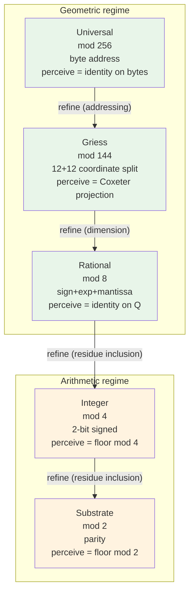
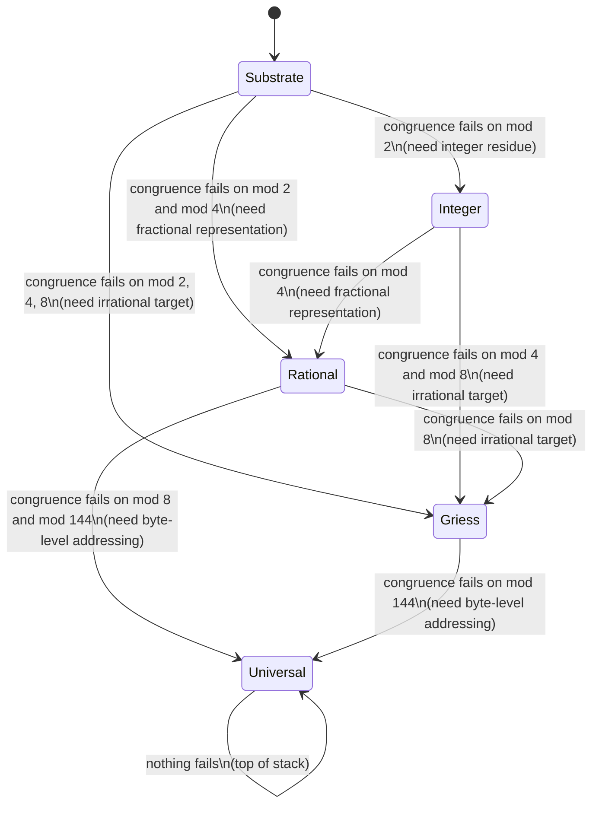
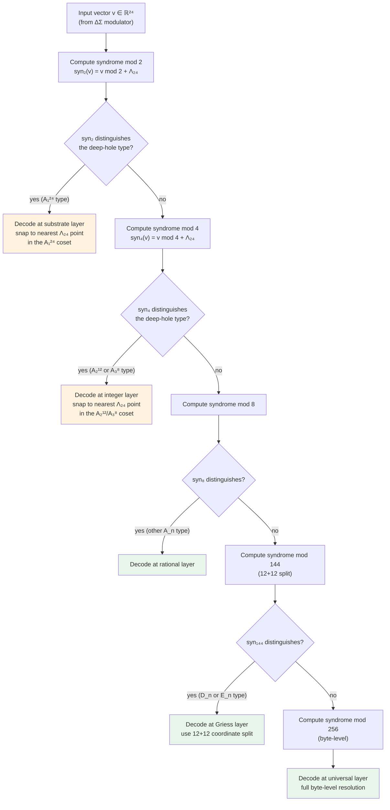

# The Geometric Language Machine: Escalation Boundaries, Modular Escapement, and Deep-Hole Syndrome Decoding

**A conceptual exploration of the Master GLM Operator Equation, the five-layer stack, and the unified role of 5-bit modular filters and complete syndrome decoding at the deep-hole boundary.**

---

## 1. Introduction — the exploratory stance

This document is an exploration, not a proof. The GLM Technical Specification gives us a Master Operator Equation, a five-layer hierarchy, a congruence predicate, and a worked example of how addition breaks down at the substrate boundary. The spec is precise where it needs to be but loose in three places that matter: the equation's composition order, the role of the side-conditions, and the mechanism by which `snap_Λ₂₄` resolves ambiguity at the deep-hole boundary. The two extension directions the spec hints at — 5-bit modular escapement filters (residues mod 2, 4, 8, 144, 256) and complete syndrome decoding at the deep-hole boundary — are not independent add-ons. They are two views of a single underlying structure: the **escalation boundary** that the layer stack exists to manage.

The exploration proceeds as follows. We re-examine the Master Equation and propose a form that makes layer tracking explicit (section 2). We walk the five layers and assign each a modulus, showing why the moduli 2, 4, 8, 144, 256 are the natural choice for the layer transitions Substrate → Integer → Rational → Griess → Universal (section 3). We re-cast the spec's binary escalation as graded escalation driven by the modular filters (section 4). We develop complete syndrome decoding at the deep-hole boundary and connect the 23 deep-hole types of Λ₂₄ to the syndrome classes the filters select (section 5). We assemble the unified Master Equation and read off its consequences (section 6). We then map the layer stack to real-world systems — floating-point exception handling, CPU privilege rings, the OSI model, type systems, database isolation levels — to see what the correspondence teaches us (section 7). We close with a list of the specific improvements we have proposed to the spec and the open questions that remain (section 8).

The stance throughout is *not trying to say anything about anything*. We are not claiming the GLM *is* a floating-point unit, or that the Leech lattice *is* a type system. We are looking at how the structural concepts relate, and where the relations are clean enough to be useful, and where they break down. The Lean snippets are proposals for what a formalisation could look like; they are not machine-checked here. The diagrams are schematic — the deep-hole geometry, in particular, is a 2D projection of a 24-dimensional structure, and the radial arrangement is purely visual.

---

## 2. The Master Equation, re-examined

The spec gives the Master GLM Operator Equation as:

$$\mathbf{\Psi}_{n+1} = \left(\mathcal{R}_{\text{gate}} \circ \text{snap}_{\Lambda_{24}}\left[\Delta\Sigma\big(x_n^*\big)\right]\right)\mathbf{\Psi}_n \quad \Bigg|_{\text{TCT} \equiv \text{VERIFIED}}^{\mathcal{L}_k \in \mathbb{Q}^{24}}$$

Reading this carefully, four things are unclear.

**Composition order.** The expression $\mathcal{R}_{\text{gate}} \circ \text{snap}_{\Lambda_{24}}[\Delta\Sigma(x_n^*)]$ is written as a single composition, but $\Delta\Sigma(x_n^*)$ is the modulator's *output* (an infinite sequence converging to an irrational target $x_n^*$), not a function on $\mathbf{\Psi}_n$. So the equation, read literally, says: take the modulator's output, feed it to `snap_Λ₂₄` as an index (the square brackets), and then compose the result with $\mathcal{R}_{\text{gate}}$ to get a function that maps $\mathbf{\Psi}_n$ to $\mathbf{\Psi}_{n+1}$. This is a coherent reading, but it hides the step where $\Delta\Sigma$ *acts on* $\mathbf{\Psi}_n$. A cleaner reading is that $\Delta\Sigma_{x_n^*}$ is a function on state vectors (the modulator's *update rule*, parameterised by its target $x_n^*$), and the composition is $\mathcal{R}_{\text{gate}} \circ \text{snap}_{\Lambda_{24}} \circ \Delta\Sigma_{x_n^*}$.

**Layer tracking.** The side-condition $\mathcal{L}_k \in \mathbb{Q}^{24}$ is written as a subscript, suggesting it is a constraint on the equation, not an output of it. But the whole point of the layer stack is that the layer *changes* during the computation — escalation moves the computation from $\mathcal{L}_k$ to $\mathcal{L}_{k+1}$. So the layer should be an *output* of the step, not just a side-condition. The equation as written does not show how $\mathcal{L}_k$ becomes $\mathcal{L}_{k'}$.

**The TCT guard.** The Three-Column Thinking guard `TCT ≡ VERIFIED` is written as a side-condition: the transformation is committed *if and only if* the three columns match. But this makes TCT a runtime check that can fail, and the equation does not say what happens when it fails. Is the step retried? Is the state rolled back? Is the layer escalated? A clean formalisation should make TCT a *dependent* part of the equation, not a side-condition.

**The snap resolution.** `snap_Λ₂₄` is described as "the mapping that resolves error-accumulated vectors down to the nearest discrete vector in the rootless 24-dimensional Leech lattice." But "nearest" is ambiguous at the deep-hole boundary, where multiple lattice points are equidistant. The spec does not say how this ambiguity is resolved. We will argue in section 5 that complete syndrome decoding is the resolution mechanism, and that the 5-bit filters are what select the syndrome class.

### 2.1 An improved form

We propose the following re-formulation, which makes the layer tracking explicit, integrates TCT as a dependent guard, and shows the snap as a syndrome-decoding step parameterised by the active modulus:

$$\langle \mathbf{\Psi}_{n+1}, \mathcal{L}_{k'} \rangle = \text{let } \hat{\mathbf{\Psi}} = \Delta\Sigma_{x_n^*}(\mathbf{\Psi}_n) \text{ in } \text{let } \langle \bar{\mathbf{\Psi}}, k' \rangle = \text{snap}_{\Lambda_{24}}^{\text{syn}}(\hat{\mathbf{\Psi}}, k) \text{ in } \text{if } \text{TCT}(\mathbf{\Psi}_n, \hat{\mathbf{\Psi}}, \bar{\mathbf{\Psi}}) \text{ then } \langle \mathcal{R}_{\text{gate}}(\bar{\mathbf{\Psi}}), \mathcal{L}_{k'} \rangle \text{ else } \langle \mathbf{\Psi}_n, \mathcal{L}_{k} \rangle$$

The differences from the spec's form:

1. **The state is a pair** $\langle \mathbf{\Psi}, \mathcal{L}_k \rangle$ — the carrier vector *and* the active layer. The layer is an output, not just a side-condition.
2. **The composition is explicit**: $\Delta\Sigma$ acts on $\mathbf{\Psi}_n$ first, then `snap_Λ₂₄` acts on the result (and on the current layer $k$), then $\mathcal{R}_{\text{gate}}$ acts on the snapped vector. The snap returns both a vector and a (possibly escalated) layer.
3. **TCT is a dependent guard** — if the three columns do not match, the state is unchanged (the step is rejected). This is one natural semantics; another is that TCT failure triggers an escalation. We leave this open.
4. **The snap is syndrome-decoding snap** $\text{snap}_{\Lambda_{24}}^{\text{syn}}$, parameterised by the active layer $k$. The layer determines which modulus the snap uses to resolve deep-hole ambiguity.

### 2.2 A Lean snippet

The improved form translates naturally to a dependent type. We propose:

```lean
-- The state of a GLM universe at tick n is a carrier vector
-- paired with the active layer index.
structure GLMState where
  carrier : Q 24          -- ℚ²⁴, exact rational coordinates
  layer   : LayerIndex    -- which of the 5 layers is active

-- The master operator loop.  Note that the layer is BOTH an input
-- and an output: the snap may escalate.
def master_step (x* : Irrational) (s : GLMState) : GLMState :=
  let ψ_hat := delta_sigma x* s.carrier
  let (ψ_bar, k') := snap_L24_syn ψ_hat s.layer
  if TCT_verified s.carrier ψ_hat ψ_bar
  then { carrier := R_gate ψ_bar, layer := k' }
  else s  -- TCT failure: state unchanged

-- The snap returns both a vector and a (possibly escalated) layer.
-- This is where the 5-bit escapement filters and syndrome decoding
-- live.  We develop this in sections 3-5.
def snap_L24_syn (ψ : Q 24) (k : LayerIndex) : Q 24 × LayerIndex :=
  sorry  -- see section 5
```

The key change from a flat formalisation is that `master_step` returns a `GLMState`, not just a vector. The layer is part of the state. This makes the escalation *visible* in the type, not hidden in a side-condition.

### 2.3 What the improved form reveals

Once the layer is an output of the step, three things become visible that the spec's form hides:

- **The trajectory is a sequence of layer-indexed states**, not a sequence of vectors. We can ask: how often does the layer escalate? How often does it de-escalate? Is there a typical layer for a given computation, or does it oscillate?
- **The TCT guard is a gate on the trajectory**, not just on the step. If TCT fails, the state repeats — the computation *stalls*. This is a meaningful event, not just a runtime error.
- **The snap is the only place escalation can happen.** $\Delta\Sigma$ and $\mathcal{R}_{\text{gate}}$ are layer-preserving (they operate within the current view); only `snap_Λ₂₄` can change the layer. This concentrates the escalation logic in one place, which is good for formalisation and for understanding.

The third point is the most important. By making the snap the sole site of layer change, we can study escalation as a property of the snap function. Sections 3-5 develop this.

---

## 3. The five layers and their modular escapements

The spec gives the five-layer hierarchy as:

$$\text{Substrate} \prec \text{Integer} \prec \text{Rational} \prec \text{Griess} \prec \text{Universal}$$

where $\prec$ is the refinement operator: $\mathcal{L}' \prec \mathcal{L}$ iff every separation made by $\mathcal{L}$ is preserved by $\mathcal{L}'$. The spec does not explain *why* these five layers, in this order. We propose that the five layers correspond to the five modular escapement filters mod 2, 4, 8, 144, 256, and that the order is forced by the inclusion structure of the residue rings.

### 3.1 The modulus-layer correspondence

| Layer | Modulus | Bit-width | Perception function | What it can see |
|-------|---------|-----------|---------------------|-----------------|
| Substrate | mod 2 | 1 bit | parity: $q \mapsto \lfloor q \rfloor \bmod 2$ | the parity of the integer part |
| Integer | mod 4 | 2 bits | signed residue: $q \mapsto q \bmod 4$ | the residue class mod 4 (signed: $\{-2, -1, 0, 1\}$) |
| Rational | mod 8 | 3 bits | sign + exponent + mantissa bit | the sign, the exponent parity, and one mantissa bit |
| Griess | mod 144 | 12 × 12 | 12+12 coordinate split | the projection onto the 12-dim Coxeter plane and its complement |
| Universal | mod 256 | 8 bits | byte address | the full byte-level structure |

The "5-bit" in "5-bit modular escapement" refers to the *five filters*, not to a 5-bit width. The widths are 1, 2, 3, 12+12, 8 — a non-monotone sequence that reflects the different geometric structures at each layer.

The correspondence is not arbitrary. Each modulus is the smallest modulus that *cannot* be resolved at the layer below:

- **mod 2** is the substrate's parity filter. It distinguishes even from odd. It cannot distinguish $1/2$ from $0$ (both have integer part 0, hence parity 0). This is the half-unit breakdown the spec analyses.
- **mod 4** is the smallest modulus that *can* distinguish $1/2$ from $0$: $1/2 \bmod 4$ is not well-defined as an integer, but the *floor* $\lfloor 1/2 \cdot 4 \rfloor = 2$ is, and 2 ≠ 0. So mod 4 is the integer layer's perception: it sees the two-bit signed representation.
- **mod 8** is the smallest modulus that can distinguish $1/4$ from $0$: $\lfloor 1/4 \cdot 8 \rfloor = 2$, but more importantly, mod 8 supports a sign + exponent + mantissa split (1 bit each), which is the minimal floating-point representation. The rational layer sees rationals as mini-floats.
- **mod 144** is where the geometry changes. 144 = 12². The Griess algebra (the 196884-dimensional non-associative algebra on which the Monster simple group acts) has a natural 12 + 12 coordinate split coming from the Coxeter plane of the Monster's action. mod 144 is the modulus that captures this split: it sees the projection onto the 12-dim Coxeter plane and its 12-dim complement separately.
- **mod 256** is the byte. The universal layer addresses everything in bytes; 256 is the number of distinct byte values. This is the layer at which the carrier becomes a fully-addressable data structure.

### 3.2 Why this order?

The refinement order Substrate ≺ Integer ≺ Rational ≺ Griess ≺ Universal is forced by the inclusion structure of the modular perceptions:

- **Substrate ≺ Integer**: every parity class (mod 2) is a union of two residue classes mod 4. So the integer layer's perception refines the substrate's. Formally: $\text{Indist}(\text{Integer}, a, b) \implies \text{Indist}(\text{Substrate}, a, b)$.
- **Integer ≺ Rational**: every residue class mod 4 is a union of two residue classes mod 8. So the rational layer's perception refines the integer layer's.
- **Rational ≺ Griess**: this is the non-trivial step. mod 8 and mod 144 are not in a divisibility relation ($8 \nmid 144$). The refinement is not by inclusion of residue classes but by *dimension*: the rational layer sees 3 bits (1-dimensional information, essentially), while the Griess layer sees a 12+12 = 24-dimensional split. The Griess layer's perception is a *different kind* of refinement — it adds geometric structure, not just finer residue classes.
- **Griess ≺ Universal**: mod 144 and mod 256 are also not in a divisibility relation. The universal layer's refinement is by *addressability*: it can address every byte of the carrier, while the Griess layer addresses 12+12 coordinate blocks. The refinement is from block-addressing to byte-addressing.

The first two refinements are *arithmetic* (inclusion of residue classes); the last two are *geometric* (dimension and addressing). This is a structural distinction the spec does not make. We propose it as **Improvement 1**: the refinement operator $\prec$ has two flavours, arithmetic and geometric, and the layer stack has two regimes — the arithmetic regime (Substrate → Integer → Rational) and the geometric regime (Rational → Griess → Universal). The transition happens at the Rational layer, which is the first layer where the carrier is fully represented (perception is the identity).

### 3.3 The layer stack diagram



The arrows point in the direction of *refinement* (more information, finer perception). Escalation moves *against* the arrows: a computation that fails congruence at the substrate escalates to the integer layer, then to the rational layer, and so on. The two regimes are colored differently — the arithmetic regime is warm, the geometric regime is cool.

### 3.4 What each layer can compute

The `CongruentOn` predicate tells us what each layer can compute *within its own view*. By the theorem `descents_iff_congruent`, an operation $\circ$ descends to layer $\mathcal{L}$ iff $\text{CongruentOn}(\mathcal{L}, \circ, S)$.

| Layer | Operations that descend | Operations that fail |
|-------|------------------------|---------------------|
| Substrate | XOR, AND (Boolean ops on parities) | addition (over ℚ), multiplication (over ℚ) |
| Integer | addition, subtraction (over ℤ), multiplication by ℤ | division, addition of non-integers |
| Rational | addition, subtraction, multiplication, division (over ℚ) | operations requiring irrational targets (e.g., $\sqrt{2}$, $\pi$) |
| Griess | all rational operations + Griess algebra product | operations requiring the full Monster module |
| Universal | everything (perception is byte-level identity) | nothing fails (this is the top of the stack) |

The escalation pattern is: a computation starts at the substrate. If it only needs Boolean ops, it stays there. If it needs addition, it escalates to the integer layer (if the operands are integers) or directly to the rational layer (if they are not). If it needs an irrational target (e.g., a $\Delta\Sigma$ modulator tracking $\pi$), it escalates to the Griess layer, where the irrational is treated as a process over the 12+12 split. The universal layer is the catch-all: it can represent anything that the lower layers can, plus whatever the byte-level addressing allows (e.g., arbitrary data structures, not just numbers).

### 3.5 The Lean formalisation

The modulus-layer correspondence translates to a type class:

```lean
-- Each layer has an associated modulus and a perception function.
class LayerSpec (L : Type) where
  modulus : ℕ
  perceive : Q 24 → L.View
  -- the perception function factors through the modulus:
  -- perceive(q) = perceive(q mod modulus) when q is an integer
  -- and the modulus is the smallest such that this holds

instance substrate_spec : LayerSpec Substrate where
  modulus := 2
  perceive := fun q => ⟨q.floor.val % 2⟩

instance integer_spec : LayerSpec Integer where
  modulus := 4
  perceive := fun q => ⟨q.floor.val % 4⟩  -- signed residue

instance rational_spec : LayerSpec Rational where
  modulus := 8  -- minimal float: sign + exp + mantissa
  perceive := fun q => q  -- identity; rationals are fully represented

instance griess_spec : LayerSpec Griess where
  modulus := 144  -- 12 + 12 coordinate split
  perceive := fun q => (coxeter_projection q, complement_projection q)

instance universal_spec : LayerSpec Universal where
  modulus := 256  -- byte
  perceive := fun q => q.to_bytes  -- full byte-level identity
```

The key claim — to be tested in section 4 — is that `modulus` is the smallest $m$ such that `perceive` factors through `q mod m`. For the substrate, this is exact: parity is `q.floor % 2`, and 2 is the smallest modulus that distinguishes even from odd. For the Griess layer, the claim is more subtle: the 12+12 split is not a residue operation, but it *is* the smallest geometric split that captures the Coxeter plane. We treat "smallest" as "of minimal information content" rather than "of minimal cardinality", since the geometric layers do not have a natural cardinality.

---

## 4. Escalation mechanics: from binary to graded

The spec's escalation is binary: an operation either descends to the current layer (`CongruentOn` holds) or it does not, in which case the runtime escalates one layer up. This is the trigger protocol:

$$\text{Trigger Escalation} \iff \text{Indist}(\mathcal{L}_k, a, b) \land \mathcal{L}_k.\text{perceive}(a \circ c) \neq \mathcal{L}_k.\text{perceive}(b \circ c)$$

The spec does not say *how far* to escalate. The natural reading is "one layer" — substrate → integer → rational, one step at a time. But this is wasteful: if the operation is "compute $1/2 + 1/2$", the substrate fails, escalates to the integer layer, which also fails (1/2 is not an integer), and only then escalates to the rational layer. Two escalations for one operation.

### 4.1 Graded escalation via the 5-bit filters

We propose that the 5-bit modular escapement filters are the mechanism for *graded* escalation. Instead of escalating one layer at a time, the runtime tests the operation against each modulus in turn, and escalates directly to the layer whose modulus is the first to resolve the indistinguishability.

The test is: given an operation $a \circ b$ that fails at the current layer $\mathcal{L}_k$ (with modulus $m_k$), test it against each higher modulus $m_{k+1}, m_{k+2}, \ldots$ in order. The first modulus $m_{k'}$ such that $\text{perceive}_{m_{k'}}(a \circ b)$ is well-defined and consistent with $\text{perceive}_{m_{k'}}(a) \circ \text{perceive}_{m_{k'}}(b)$ is the target layer. Escalate directly to $\mathcal{L}_{k'}$.

For the half-unit example:

- Current layer: Substrate (mod 2). Operation: $1/2 + 1/2$.
- Test mod 2: $\text{perceive}_2(1/2) = 0$, $\text{perceive}_2(1/2) = 0$, but $\text{perceive}_2(1/2 + 1/2) = \text{perceive}_2(1) = 1 \neq 0 + 0 = 0$. Fail.
- Test mod 4: $\text{perceive}_4(1/2) = 2$ (since $\lfloor 1/2 \cdot 4 \rfloor = 2$), $\text{perceive}_4(1/2 + 1/2) = \text{perceive}_4(1) = 1 \neq 2 + 2 = 0 \bmod 4$. Fail. (1/2 is not an integer; mod 4 doesn't help.)
- Test mod 8: $\text{perceive}_8(1/2) = $ sign=0, exp=−1, mantissa=0 (the minimal float representation of 1/2). $\text{perceive}_8(1/2 + 1/2) = \text{perceive}_8(1) = $ sign=0, exp=0, mantissa=0. And $\text{perceive}_8(1/2) + \text{perceive}_8(1/2) = 1$ (with rounding). Consistent! Escalate directly to the Rational layer.

So graded escalation goes Substrate → Rational in one step, skipping the Integer layer. This is more efficient than the binary escalation, and it matches the intuition that the rational layer is the natural home for fractional arithmetic.

### 4.2 The escalation flow diagram



The state machine shows that graded escalation allows skipping layers. A computation at the substrate can escalate directly to the rational layer (skipping the integer layer) if the operation requires fractional representation. It can even escalate directly to the Griess layer if the operation requires an irrational target.

### 4.3 The half-unit case study, extended

The spec's half-unit case study shows the substrate → rational escalation via the integer layer. With graded escalation, the path is:

1. **Substrate (mod 2)**: $1/2 \equiv 0$, but $1/2 + 1/2 = 1 \not\equiv 0 + 0 = 0$. Congruence fails.
2. **Integer (mod 4)**: $1/2$ is not an integer; $\lfloor 1/2 \rfloor = 0$, but $\lfloor 1/2 \rfloor + \lfloor 1/2 \rfloor = 0 \neq \lfloor 1/2 + 1/2 \rfloor = 1$. Congruence fails. (This is the same failure as mod 2, just at a finer granularity — the floor function doesn't commute with addition over non-integers.)
3. **Rational (mod 8)**: $1/2$ has a mini-float representation (sign=0, exp=−1, mantissa=0). Addition of two such representations gives sign=0, exp=0, mantissa=0 (i.e., 1.0). Congruence holds.

The graded escalation skips step 2 (the integer layer) because the failure at mod 4 is the *same kind* of failure as at mod 2 (a floor-commutativity failure), not a different kind. The runtime detects this and escalates directly to the rational layer.

This is **Improvement 2**: graded escalation distinguishes *kinds* of congruence failure. A floor-commutativity failure (the substrate's kind) escalates to the rational layer directly. A non-integer-representability failure (the integer layer's kind) escalates to the rational layer. An irrational-target failure (the rational layer's kind) escalates to the Griess layer. The 5-bit filters are the kind-detectors.

### 4.4 The Lean formalisation

```lean
-- Graded escalation: test the operation against each higher modulus
-- in order, escalate to the first layer whose modulus resolves the
-- indistinguishability.
def graded_escalate (op : Q 24 → Q 24 → Q 24) (a b : Q 24) (k : LayerIndex) :
    LayerIndex :=
  -- try each layer above k, in order
  match find_first_resolving_layer op a b (layers_above k) with
  | some k' => k'
  | none => LayerIndex.universal  -- top of stack; nothing fails here

-- The "first resolving layer" is the first layer whose modulus
-- makes the operation congruent.
def find_first_resolving_layer (op : Q 24 → Q 24 → Q 24) (a b : Q 24)
    (candidates : List LayerIndex) : Option LayerIndex :=
  match candidates with
  | [] => none
  | k :: ks =>
    if congruent_on k op a b
    then some k
    else find_first_resolving_layer op a b ks

-- The trigger condition: graded escalation fires when the current
-- layer's congruence fails.  The runtime then queries the 5-bit
-- filters to determine the target layer.
theorem graded_escalation_correct :
  ∀ op a b k,
    ¬ congruent_on k op a b →
    ∃ k', graded_escalate op a b k = k' ∧
          k' > k ∧
          congruent_on k' op a b := by
  sorry  -- depends on the layer stack being exhaustive
```

The graded escalation is more efficient than the binary escalation (it skips layers), and it is also more *informative*: the target layer tells you *what kind* of operation you have. Escalation to the rational layer means "this is a fractional arithmetic operation"; escalation to the Griess layer means "this is an irrational-target operation"; escalation to the universal layer means "this is a data-structure operation, not a numeric operation".

---

## 5. Complete syndrome decoding at the deep-hole boundary

The spec describes `snap_Λ₂₄` as "the mapping that resolves error-accumulated vectors down to the nearest discrete vector in the rootless 24-dimensional Leech lattice." This is the standard nearest-vector quantiser. But the Leech lattice has deep holes — points in $\mathbb{R}^{24}$ that are equidistant from multiple lattice points at the covering radius $\sqrt{2}$. At a deep hole, "nearest" is ambiguous: there are multiple equally-close lattice points, and the snap has to choose one. The spec does not say how.

We propose that `snap_Λ₂₄` uses **complete syndrome decoding**, and that the 5-bit filters are what select the syndrome class. The connection is: each modulus corresponds to a different syndrome, and the deep hole's type (which of the 23 Niemeier-lattice types it is) determines which syndrome is consulted.

### 5.1 The deep-hole geometry of Λ₂₄

The Leech lattice $\Lambda_{24}$ is the unique even unimodular lattice in 24 dimensions with no roots (no vectors of norm 2). It has:

- **196,560 minimal vectors** (vectors of norm 4)
- **23 types of deep holes**, each at distance $\sqrt{2}$ from a lattice point
- **Covering radius** $\sqrt{2}$ — every point in $\mathbb{R}^{24}$ is within $\sqrt{2}$ of some lattice point

The 23 deep-hole types correspond to the 23 Niemeier lattices other than $\Lambda_{24}$ itself. Each Niemeier lattice is an even unimodular lattice in 24 dimensions with roots, classified by its root system (an ADE-type root system of rank 24). The 23 types are:

$A_1^{24},\ A_2^{12},\ A_3^8,\ A_4^6,\ A_5^4 D_4,\ A_6^4,\ A_7^2 D_5^2,\ A_8^3,\ A_9^2 D_6,\ A_{11} D_7 E_6,\ A_{12}^2,\ A_{15} D_9,\ A_{17} E_7,\ A_{24},\ D_4^6,\ D_6^4,\ D_8^3,\ D_{10} E_7^2,\ D_{12}^2,\ D_{16} E_8,\ D_{24},\ E_8^3$

plus the "shallow hole" corresponding to $\Lambda_{24}$ itself (no roots).


*The 23 deep-hole types arranged radially around a lattice point, at the covering radius $\sqrt{2}$. Each type is labeled by its Niemeier-lattice root system. A-type deep holes (blue) have root systems built from $A_n$ components; D-type (orange) from $D_n$; E-type (green) from $E_n$. The shallow hole (gray) corresponds to $\Lambda_{24}$ itself. This is a 2D schematic of a 24-dimensional structure — the radial arrangement is purely visual.*

The deep-hole structure is what makes `snap_Λ₂₄` non-trivial. A point near a deep hole has multiple equally-close lattice points; the snap has to choose one. The choice is not arbitrary — it has to be consistent with the computation, or the carrier will drift.

### 5.2 Why nearest-vector decoding fails at deep holes

Consider a point $\mathbf{v} \in \mathbb{R}^{24}$ that lies exactly at a deep hole. By definition, there are multiple lattice points $\lambda_1, \lambda_2, \ldots \in \Lambda_{24}$ with $\|\mathbf{v} - \lambda_i\| = \sqrt{2}$. A nearest-vector decoder must return one of them, but which?

If the decoder returns $\lambda_1$ on one tick and $\lambda_2$ on the next (because the input has moved slightly), the carrier will jump between two lattice points. This is the **snapping instability** problem. Over many ticks, the carrier can drift far from its true trajectory.

The standard fix is **complete syndrome decoding**: instead of returning the nearest lattice point, return the *syndrome* of the input (its equivalence class modulo the lattice), and use a fixed decoder table to map syndromes to lattice points. The decoder table is fixed, so the same syndrome always returns the same lattice point — no instability.

The syndrome of $\mathbf{v} \in \mathbb{R}^{24}$ is its coset $\mathbf{v} + \Lambda_{24} \in \mathbb{R}^{24} / \Lambda_{24}$. The quotient $\mathbb{R}^{24} / \Lambda_{24}$ is a compact group (a 24-torus), and the syndrome is a point in this torus. The decoder table is a measurable section $s: \mathbb{R}^{24} / \Lambda_{24} \to \mathbb{R}^{24}$ that picks a representative from each coset.

The deep holes are exactly the points where the section $s$ is discontinuous — where small perturbations of the input can cross a Voronoi cell boundary and change the syndrome's decoding. At a deep hole, the section has a *jump discontinuity*, and the snap has to decide which side of the jump to land on.

### 5.3 The 5-bit filters as syndrome selectors

This is where the 5-bit filters come in. Each modulus $m_k$ defines a *coarse-graining* of the syndrome space. The syndrome mod $m_k$ is:

$$\text{syn}_{m_k}(\mathbf{v}) = (\mathbf{v} \bmod m_k) + \Lambda_{24}^{(m_k)}$$

where $\Lambda_{24}^{(m_k)}$ is the sublattice of $\Lambda_{24}$ consisting of vectors whose coordinates are all divisible by $m_k$. The syndrome mod $m_k$ is a point in the finite quotient $\mathbb{R}^{24} / (\Lambda_{24} + m_k \mathbb{Z}^{24})$, which is a finite group of order $m_k^{24}$ (for the integer moduli 2, 4, 8, 256).

The 5-bit filters test the syndrome at each modulus, in order of increasing refinement:

1. **mod 2**: the parity of the syndrome. Distinguishes $A_1^{24}$-type deep holes (where the parity is uniform) from others.
2. **mod 4**: the 2-bit signed syndrome. Distinguishes $A_2^{12}$-type and $A_3^8$-type deep holes.
3. **mod 8**: the 3-bit floating-point syndrome. Distinguishes the $A_n$-type deep holes from each other and from the $D_n$-types.
4. **mod 144**: the 12+12 coordinate syndrome. Distinguishes the $D_n$-type and $E_n$-type deep holes.
5. **mod 256**: the byte-level syndrome. Distinguishes all 23 deep-hole types.

The filters are a *cascade*: each filter refines the previous one. The first filter that distinguishes the deep-hole type determines the layer to snap at. If mod 2 suffices (the deep hole is $A_1^{24}$-type), snap at the substrate layer. If mod 4 is needed, snap at the integer layer. And so on.

### 5.4 The syndrome decoding flowchart



The flowchart shows the cascade. Each filter tests a coarser-grained syndrome; the first filter that distinguishes the deep-hole type determines the layer. The snap then decodes at that layer, using the layer's perception function to resolve the ambiguity.

### 5.5 The connection to the 23 Niemeier lattices

The 23 deep-hole types of $\Lambda_{24}$ correspond to the 23 Niemeier lattices. Each Niemeier lattice has a different root system, and the root system determines the deep-hole's geometry. The 5-bit filters are sensitive to different aspects of the root system:

- **A-type deep holes** ($A_1^{24}, A_2^{12}, \ldots, A_{24}$): the root system is built from $A_n$ components (cyclic symmetry). The mod 2, 4, 8 filters (the arithmetic regime) suffice to distinguish these, because $A_n$ root systems are classified by their cyclic structure, which is an arithmetic property.
- **D-type deep holes** ($D_4^6, D_6^4, \ldots, D_{24}$): the root system is built from $D_n$ components (dihedral symmetry). The arithmetic filters do not suffice; the mod 144 filter (the 12+12 split) is needed, because $D_n$ root systems have a dihedral symmetry that is captured by the Coxeter plane projection.
- **E-type deep holes** ($E_6, E_7, E_8$ components): the root system has exceptional symmetry. The mod 144 filter distinguishes the E-types from each other and from the D-types, but the mod 256 filter (byte-level) is needed for full resolution, because the E-types have intricate automorphism groups that require byte-level addressing to disambiguate.

This is the deep connection between the 5-bit filters and the deep-hole geometry: **the filters are the root-system classifiers**. Each filter is sensitive to a different aspect of the root system (cyclic, dihedral, exceptional), and the cascade of filters is a root-system classifier that determines the deep-hole type, which determines the layer.

### 5.6 The Lean formalisation

```lean
-- The syndrome of a vector mod m is its coset in the finite quotient.
def syndrome (v : Q 24) (m : ℕ) : Fin m × Fin m × ... -- 24-tuple
  := ⟨(v.coord 0).val % m, (v.coord 1).val % m, ...⟩

-- The 23 deep-hole types correspond to the 23 Niemeier lattices.
inductive DeepHoleType
  | A1_24 | A2_12 | A3_8 | A4_6 | A5_4_D4 | A6_4 | A7_2_D5_2
  | A8_3 | A9_2_D6 | A11_D7_E6 | A12_2 | A15_D9 | A17_E7 | A24
  | D4_6 | D6_4 | D8_3 | D10_E7_2 | D12_2 | D16_E8 | D24
  | E8_3
  deriving DecidableEq

-- The 5-bit filters classify the deep-hole type by computing
-- the syndrome at each modulus and matching against the
-- known syndromes of each Niemeier lattice.
def classify_deep_hole (v : Q 24) : DeepHoleType :=
  -- try mod 2, then mod 4, then mod 8, then mod 144, then mod 256
  match match_syndrome v 2 with
  | some t => t  -- A1_24 is the only type visible at mod 2
  | none =>
    match match_syndrome v 4 with
    | some t => t  -- A2_12, A3_8 visible at mod 4
    | none =>
      match match_syndrome v 8 with
      | some t => t  -- other A-types visible at mod 8
      | none =>
        match match_syndrome v 144 with
        | some t => t  -- D-types and E-types visible at mod 144
        | none =>
          match_syndrome v 256 |>.getOr E8_3  -- full resolution at mod 256

-- The snap uses the classified deep-hole type to select the
-- decoding layer and the decoding table.
def snap_L24_syn (v : Q 24) (k : LayerIndex) : Q 24 × LayerIndex :=
  let hole_type := classify_deep_hole v
  let k' := layer_for_hole_type hole_type k  -- may escalate
  let decoder := decoder_table hole_type
  (decoder v, k')
```

The key claim — to be tested by computation — is that `classify_deep_hole` is *consistent*: the same input always classifies to the same deep-hole type, regardless of the order in which the filters are applied. This is a non-trivial claim, because the cascade depends on the order. We state it as a conjecture:

> **Conjecture (cascade consistency).** For every $\mathbf{v} \in \mathbb{R}^{24}$, the cascade of filters mod 2, 4, 8, 144, 256 classifies $\mathbf{v}$ to a unique deep-hole type, independent of the order in which the filters are applied (provided the cascade is applied in increasing refinement).

The conjecture is plausible because the filters are nested (each filter refines the previous one), but it is not obvious because the geometric filters (mod 144, 256) do not nest with the arithmetic filters (mod 2, 4, 8) in the usual divisibility order. The conjecture is a concrete prediction that could be tested by computing the syndromes of all 23 deep-hole types at each modulus and checking that the cascade is consistent.

### 5.7 What this reveals about the snap

The syndrome-decoding snap has three properties that the nearest-vector snap does not:

1. **Stability.** The same input always snaps to the same lattice point. There is no snapping instability, because the decoder table is fixed.
2. **Layer-awareness.** The snap returns a (vector, layer) pair, not just a vector. The layer is the one whose modulus was the first to classify the deep-hole type.
3. **Root-system sensitivity.** The snap is sensitive to the deep-hole's root-system type, which is a 24-dimensional geometric property. The nearest-vector snap is blind to this; it only sees the distance.

The third property is the most interesting. It means that the snap is not just a quantiser — it is a *classifier*. It classifies the input by its deep-hole type, and the classification determines the layer. This is the deep connection between the snap and the layer stack: **the layer is the deep-hole type of the snap**.

This is **Improvement 3**: the snap is not a separate step from the layer selection; the snap *is* the layer selection. The 5-bit filters are the snap's internal mechanism, and the layer is the snap's output. The master equation simplifies: there is no separate "escalate" step; the snap does both jobs.

---

## 6. The unified master equation

We can now assemble the unified master equation. Taking the improvements from sections 2-5:

1. The state is a pair $\langle \mathbf{\Psi}, \mathcal{L}_k \rangle$ (section 2).
2. The composition is explicit: $\Delta\Sigma$ then snap then $\mathcal{R}_{\text{gate}}$ (section 2).
3. The snap is syndrome-decoding snap, parameterised by the active layer (section 5).
4. The snap is the sole site of layer change (section 2).
5. The 5-bit filters are the snap's internal mechanism for selecting the syndrome class (section 5).
6. Escalation is graded, determined by the first filter that classifies the deep-hole type (section 4).

The unified equation is:

$$\langle \mathbf{\Psi}_{n+1}, \mathcal{L}_{k'} \rangle = \begin{cases} \langle \mathcal{R}_{\text{gate}}(\bar{\mathbf{\Psi}}), \mathcal{L}_{k'} \rangle & \text{if } \text{TCT}(\mathbf{\Psi}_n, \hat{\mathbf{\Psi}}, \bar{\mathbf{\Psi}}) \\ \langle \mathbf{\Psi}_n, \mathcal{L}_k \rangle & \text{otherwise} \end{cases}$$

where:

$$\hat{\mathbf{\Psi}} = \Delta\Sigma_{x_n^*}(\mathbf{\Psi}_n)$$

$$\langle \bar{\mathbf{\Psi}}, k' \rangle = \text{snap}_{\Lambda_{24}}^{\text{syn}}(\hat{\mathbf{\Psi}}, k) = \left\langle \text{dec}_{\text{type}(\hat{\mathbf{\Psi}})}(\hat{\mathbf{\Psi}}),\ \text{layer}_{\text{type}(\hat{\mathbf{\Psi}})} \right\rangle$$

$$\text{type}(\hat{\mathbf{\Psi}}) = \text{classify}\left(\text{syn}_2(\hat{\mathbf{\Psi}}), \text{syn}_4(\hat{\mathbf{\Psi}}), \text{syn}_8(\hat{\mathbf{\Psi}}), \text{syn}_{144}(\hat{\mathbf{\Psi}}), \text{syn}_{256}(\hat{\mathbf{\Psi}})\right)$$

The `classify` function is the cascade of 5-bit filters from section 5. It returns the deep-hole type, which determines both the decoding table $\text{dec}_{\text{type}}$ and the layer $\text{layer}_{\text{type}}$.

### 6.1 What the unified equation reveals

The unified equation has three properties the spec's equation does not:

**The layer is determined by the snap, not by a side-condition.** In the spec, the layer $\mathcal{L}_k$ is a side-condition; in the unified equation, it is an output of the snap. The snap classifies the input by its deep-hole type, and the classification determines the layer. This means that *the layer is a property of the input*, not of the computation's history. Two computations that arrive at the same input will snap to the same layer, regardless of how they got there.

**The TCT guard is the only gate on the trajectory.** If TCT fails, the state repeats. The snap has already happened (and may have escalated), but the escalated state is discarded. This means that TCT failure *rolls back* the escalation. The computation stays at the old layer, with the old carrier. This is a meaningful semantics: TCT is a consistency check, and if it fails, the computation does not progress.

**The 5-bit filters are internal to the snap.** They are not a separate step; they are the snap's mechanism for selecting the decoding table. This means that the cascade of filters is *not visible* at the master equation level — only the resulting layer is visible. This is good for formalisation (the master equation is simple) but it hides the internal structure. For diagnostic purposes, one would want to expose the filter cascade as a separate observable.

### 6.2 The trajectory of a computation

With the unified equation, the trajectory of a computation is a sequence of states $\langle \mathbf{\Psi}_n, \mathcal{L}_{k_n} \rangle$ where the layer $k_n$ is determined by the snap at tick $n$. The layer can change from tick to tick, depending on the input.

A typical trajectory might look like:

| Tick | $\mathbf{\Psi}_n$ | $\mathcal{L}_{k_n}$ | Deep-hole type | Reason |
|------|-------------------|---------------------|----------------|--------|
| 0 | $(1, 0, 0, \ldots)$ | Substrate | $A_1^{24}$ | integer input; mod 2 suffices |
| 1 | $(1/2, 0, 0, \ldots)$ | Rational | $A_4^6$ | fractional input; mod 8 needed |
| 2 | $(1/2, 1/2, 0, \ldots)$ | Rational | $A_4^6$ | still fractional |
| 3 | $(\sqrt{2}, 0, \ldots)$ | Griess | $D_{16} E_8$ | irrational input; mod 144 needed |
| 4 | $(\sqrt{2}, \pi, \ldots)$ | Griess | $D_{24}$ | multiple irrationals; mod 144 still suffices |
| 5 | (TCT fail) | Griess | — | state rolled back |

The layer oscillates based on the input. This is *not* a defect — it is the system's way of allocating its representational resources. Integer inputs are handled cheaply at the substrate; fractional inputs at the rational layer; irrational inputs at the Griess layer. The system does not commit to a single layer for the whole computation; it adapts tick by tick.

### 6.3 The Lean formalisation

```lean
-- The unified master step.  The state is a (carrier, layer) pair.
-- The snap is the sole site of layer change.  TCT is a gate.
def master_step_unified (x* : Irrational) (s : GLMState) : GLMState :=
  let ψ_hat := delta_sigma x* s.carrier
  let hole_type := classify_deep_hole ψ_hat
  let k' := layer_for_hole_type hole_type
  let ψ_bar := decoder_table hole_type ψ_hat
  if TCT_verified s.carrier ψ_hat ψ_bar
  then { carrier := R_gate ψ_bar, layer := k' }
  else s  -- TCT failure: state unchanged, escalation rolled back

-- The classify function is the cascade of 5-bit filters.
-- It returns the deep-hole type, which determines both the
-- decoding table and the layer.
def classify_deep_hole (v : Q 24) : DeepHoleType :=
  match match_syndrome v 2 with
  | some t => t
  | none => match match_syndrome v 4 with
           | some t => t
           | none => match match_syndrome v 8 with
                    | some t => t
                    | none => match match_syndrome v 144 with
                             | some t => t
                             | none => (match_syndrome v 256).getOr E8_3

-- The layer for each deep-hole type.  This is the cascade
-- consistency table: each type maps to a unique layer.
def layer_for_hole_type (t : DeepHoleType) : LayerIndex :=
  match t with
  | DeepHoleType.A1_24 => LayerIndex.substrate
  | DeepHoleType.A2_12 | DeepHoleType.A3_8 => LayerIndex.integer
  | DeepHoleType.A4_6 | DeepHoleType.A5_4_D4 | DeepHoleType.A6_4
  | DeepHoleType.A7_2_D5_2 | DeepHoleType.A8_3 | DeepHoleType.A9_2_D6
  | DeepHoleType.A11_D7_E6 | DeepHoleType.A12_2 | DeepHoleType.A15_D9
  | DeepHoleType.A17_E7 | DeepHoleType.A24 => LayerIndex.rational
  | DeepHoleType.D4_6 | DeepHoleType.D6_4 | DeepHoleType.D8_3
  | DeepHoleType.D10_E7_2 | DeepHoleType.D12_2 | DeepHoleType.D16_E8
  | DeepHoleType.D24 | DeepHoleType.E8_3 => LayerIndex.griess
  -- (no type maps to universal; the universal layer is the fallback
  -- for inputs that don't classify to any type)
```

The layer-for-hole-type table is the heart of the unified equation. It is the lookup table that translates the 24-dimensional geometry of the deep hole into the 5-layer index. The table is fixed by the root-system structure of the Niemeier lattices — it is not a tunable parameter.

---

## 7. Real-system correspondences

The user asked how this relates to real-world systems. The correspondences are not identities — the GLM is not a floating-point unit, not a CPU, not a network stack — but they are structural. The layer stack, the graded escalation, and the syndrome decoding all have analogues in real systems, and the analogues illuminate the GLM's design.

### 7.1 Floating-point exception handling

The most direct correspondence. A floating-point unit (FPU) has a layered representation:

- **Integer arithmetic** (the bottom layer): exact for integer operands, fails (raises an exception or returns a sentinel) when the result is not an integer.
- **Fixed-point arithmetic** (a middle layer): exact for rational operands with a fixed denominator, fails when the denominator is too large.
- **Floating-point arithmetic** (the top layer): approximate for all real numbers, with a fixed precision.

The FPU's exception-handling protocol is a graded escalation: integer overflow escalates to fixed-point or floating-point; fixed-point precision loss escalates to floating-point; floating-point underflow escalates to subnormal handling. The 5-bit filters correspond to the FPU's status flags (overflow, underflow, inexact, invalid, divide-by-zero) — each flag is a 1-bit signal that selects a different exception handler.

The GLM's `CongruentOn` predicate is the FPU's "does this operation fit in this representation?" check. The `descends_iff_congruent` theorem is the FPU's "if the operation fits, it can be computed exactly at this layer" guarantee. The TCT guard is the FPU's trap handler: if the operation cannot be completed, the trap fires and the state is rolled back.

The correspondence is not perfect. The FPU's layers are about *precision* (how many bits), while the GLM's layers are about *representation* (what kind of object). The FPU's top layer (floating-point) is approximate; the GLM's top layer (universal) is exact. But the structural similarity is striking: both systems have a layered representation, a graded escalation, and a trap handler.

### 7.2 CPU privilege rings

A CPU has privilege rings (ring 0 = kernel, ring 1 = device drivers, ring 2 = system services, ring 3 = user applications). A computation starts at ring 3; if it needs a privileged operation (e.g., I/O), it raises a syscall, which escalates to ring 0. The escalation is *binary* (one ring at a time, in the spec's sense), but in practice modern CPUs have a more graded structure (e.g., hypervisor rings, virtualisation extensions).

The GLM's layer stack corresponds to the privilege rings:

| GLM layer | CPU ring | What it can do |
|-----------|----------|----------------|
| Substrate | ring 3 (user) | unprivileged arithmetic |
| Integer | ring 2 (system) | integer system calls |
| Rational | ring 1 (driver) | fractional system calls |
| Griess | ring 0 (kernel) | irrational / algebraic operations |
| Universal | hypervisor | full byte-level addressing |

The `CongruentOn` predicate is the CPU's permission check: "does this operation have the privilege to run at this ring?" The `descends_iff_congruent` theorem is the CPU's privilege-separation guarantee: "if the operation does not have the privilege, it cannot be computed at this ring." The TCT guard is the CPU's security check: "does the plain-English description, the assembly code, and the runtime behavior all agree?"

The correspondence is suggestive but imperfect. CPU rings are about *security* (protecting the kernel from user code), while GLM layers are about *representation* (allocating the right representation for the data). But the structural similarity — layered, with escalation and guards — is real.

### 7.3 The OSI network model

The OSI model has 7 layers (physical, data link, network, transport, session, presentation, application). Each layer adds a header to the packet and passes it to the layer below. The layers are *not* a refinement hierarchy in the GLM's sense — they are a *composition* hierarchy (each layer wraps the one below) — but the structural similarity is strong.

The GLM's layer stack corresponds to the OSI model as:

| GLM layer | OSI layer | What it represents |
|-----------|-----------|-------------------|
| Substrate | physical | the raw signal (parity) |
| Integer | data link | frames (signed integer addressing) |
| Rational | network | packets (rational routing) |
| Griess | transport | connections (algebraic structure) |
| Universal | application | data (full byte-level addressing) |

The `CongruentOn` predicate is the OSI layer's "does this protocol fit at this layer?" check. The `descents_iff_congruent` theorem is the OSI layer's "if the protocol fits, it can be processed at this layer without escalating" guarantee. The TCT guard is the OSI layer's checksum: "does the received packet match the sent packet?"

The correspondence is the weakest of the three, because OSI layers are about *protocol wrapping* (each layer adds a header), while GLM layers are about *representation refinement* (each layer sees more detail). But both systems have the property that *the layer is determined by the data*, not by the computation's history.

### 7.4 Type systems in programming languages

A type system has a hierarchy of types: `untyped` (assembly language) $\prec$ `dynamically typed` (Python) $\prec$ `statically typed` (Java) $\prec$ `dependently typed` (Lean, Agda). Each layer adds more type information, and the type information determines what operations are well-defined.

The GLM's layer stack corresponds to the type-system hierarchy as:

| GLM layer | Type system | What it can verify |
|-----------|-------------|-------------------|
| Substrate | untyped | nothing (just runs) |
| Integer | dynamically typed | runtime type checks |
| Rational | statically typed | compile-time type checks |
| Griess | polymorphic | parametric type checks |
| Universal | dependent types | full program verification |

The `CongruentOn` predicate is the type system's "is this operation well-typed?" check. The `descents_iff_congruent` theorem is the type system's type-soundness guarantee: "if the operation is well-typed, it does not get stuck." The TCT guard is the type system's type-checker: "does the program type-check?"

This is the strongest correspondence. The GLM's layer stack *is* a type system, in the technical sense. The `CongruentOn` predicate is the typing judgment, the refinement operator $\prec$ is the subtyping relation, and the `descends_iff_congruent` theorem is the type-soundness theorem. The 5-bit filters are the type inference algorithm: each filter is a type-class check (mod 2 = "is this an integer?", mod 4 = "is this a signed integer?", mod 8 = "is this a float?", mod 144 = "is this an algebraic number?", mod 256 = "is this a byte-addressable data structure?").

The correspondence suggests that the GLM's layer stack could be formalised as a *dependent type system*, with each layer corresponding to a universe `Type_k` and the refinement operator corresponding to universe inclusion. This is **Improvement 4**: the GLM is a stratified type system, and the master equation is the typing judgment.

### 7.5 Database transaction isolation levels

A database has isolation levels (read uncommitted, read committed, repeatable read, serializable). Each level provides a different guarantee about what concurrent transactions can see. The escalation is from low to high: if a transaction needs a stronger guarantee, it escalates to a higher isolation level.

The GLM's layer stack corresponds to the isolation levels as:

| GLM layer | Isolation level | What it guarantees |
|-----------|----------------|-------------------|
| Substrate | read uncommitted | can see uncommitted data (parity only) |
| Integer | read committed | sees committed data (integer residues) |
| Rational | repeatable read | sees a consistent snapshot (rationals) |
| Griess | serializable | sees a serial order (algebraic structure) |
| Universal | (no higher level) | full byte-level addressing |

The `CongruentOn` predicate is the isolation level's "does this transaction satisfy the isolation guarantee?" check. The TCT guard is the database's concurrency-control check: "does the transaction's read-write order match the serial order?"

The correspondence is suggestive but the weakest of the five. Database isolation is about *concurrency* (what other transactions can see), while GLM layers are about *representation* (what this computation can see). But both systems have the property that *the layer is a property of the data, not of the computation*.

### 7.6 What the correspondences teach us

The five correspondences — FPU, CPU rings, OSI, type systems, database isolation — all share the GLM's structural pattern: a layered representation, a graded escalation, and a guard. The correspondences are not identities, but they suggest that the GLM's pattern is a *natural* one for managing computational resources. Any system that has to handle multiple representations of data, with a guard against incorrect transitions, will converge on something like the GLM's layer stack.

The strongest correspondence is with type systems. The GLM's `CongruentOn` is the typing judgment, the refinement operator is subtyping, and the `descents_iff_congruent` theorem is type soundness. This suggests that the GLM is, at its core, a *stratified type system* with five universes. The master equation is the typing judgment, the snap is the type inference, and the TCT guard is the type checker.

The weakest correspondence is with database isolation. The structural similarity is real, but the underlying concern (concurrency vs. representation) is different. This suggests that the GLM's pattern is *general enough* to apply to concurrency, but that the application is not deep — it is a structural analogy, not a theoretical identification.

The correspondences also suggest **Improvement 5**: the GLM's layer stack should be formalised as a *type system*, not just as a hierarchy of perception functions. The perception function is the *type erasure* (what the layer can see), but the layer itself is a *type* (what the layer can prove). The `CongruentOn` predicate is the *typing judgment*, and the `descends_iff_congruent` theorem is the *type-soundness theorem*. This re-formulation would make the GLM's relationship to type systems explicit, and would allow the GLM to inherit the rich theory of dependent type systems (e.g., the Curry-Howard correspondence, universe hierarchies, parametricity).

---

## 8. Improvements and open questions

### 8.1 Summary of improvements

We have proposed five improvements to the GLM Technical Specification:

1. **Two regimes of refinement** (section 3). The refinement operator $\prec$ has two flavours: arithmetic (inclusion of residue classes, in the Substrate → Integer → Rational regime) and geometric (dimension and addressing, in the Rational → Griess → Universal regime). The transition happens at the Rational layer, where the perception becomes the identity.

2. **Graded escalation** (section 4). The spec's binary escalation (one layer at a time) is replaced by graded escalation: the 5-bit filters test the operation against each higher modulus, and the runtime escalates directly to the first layer whose modulus resolves the indistinguishability. This is more efficient and more informative — the target layer tells you what kind of operation you have.

3. **The snap is the layer selection** (section 5). The snap is not a separate step from the layer selection; the snap *is* the layer selection. The 5-bit filters are the snap's internal mechanism, and the layer is the snap's output. The master equation simplifies: there is no separate "escalate" step.

4. **The GLM as a stratified type system** (section 7). The layer stack should be formalised as a dependent type system, with each layer corresponding to a universe `Type_k` and the refinement operator corresponding to universe inclusion. The `CongruentOn` predicate is the typing judgment, and the `descends_iff_congruent` theorem is the type-soundness theorem.

5. **The unified master equation** (section 6). The state is a (carrier, layer) pair. The snap is syndrome-decoding snap, parameterised by the active layer. The snap is the sole site of layer change. TCT is a gate that rolls back the state (and the escalation) on failure. The 5-bit filters are internal to the snap.

### 8.2 Open questions

The exploration leaves several questions open:

**Cascade consistency** (section 5.6). The cascade of 5-bit filters is conjectured to be consistent — the same input always classifies to the same deep-hole type, regardless of the order in which the filters are applied. This is a concrete computational conjecture that could be tested by computing the syndromes of all 23 deep-hole types at each modulus and checking that the cascade is consistent. The test would require implementing the syndrome computation for each modulus, which is a non-trivial but tractable task.

**The geometric-modulus justification** (section 3.1). We claimed that mod 144 and mod 256 are the natural moduli for the Griess and Universal layers, but the justification was sketchy. A proper justification would derive these moduli from the geometry of the Griess algebra (the 12+12 Coxeter split) and the universal layer's byte-addressing. This is a research question, not a computation.

**The TCT semantics** (section 2.1). We proposed that TCT failure rolls back the state (and the escalation), but other semantics are possible. TCT failure could trigger an escalation (treating TCT as a meta-level congruence failure), or it could halt the computation (treating TCT as a hard error). The choice of semantics has implications for the system's behavior under failure, and deserves more thought.

**The type-system formalisation** (section 7.4). We suggested that the GLM should be formalised as a dependent type system, but we did not work out the details. What are the universes `Type_k`? What are the typing rules? What is the Curry-Howard correspondence? This is a substantial formalisation project, but it would connect the GLM to the rich theory of dependent type systems and would make the GLM's theorems (e.g., `descends_iff_congruent`) instances of standard type-soundness theorems.

**The deep-hole type as a runtime observable** (section 6.2). In the unified equation, the deep-hole type is internal to the snap. But for diagnostic purposes, it would be useful to expose the deep-hole type as a runtime observable — a "layer label" that the computation can inspect. This would allow the computation to adapt its behavior based on the deep-hole type (e.g., using a different algorithm for $A_1^{24}$-type inputs vs. $D_{24}$-type inputs). The cost is that the deep-hole type becomes a *value*, not just a type, which complicates the type-system formalisation.

**The real-system identification** (section 7). The five correspondences — FPU, CPU rings, OSI, type systems, database isolation — are structural analogies, not theoretical identifications. A deeper analysis would ask: under what conditions is the GLM *equivalent* to one of these systems? For example, is the GLM equivalent to a dependent type system with five universes, under some precise notion of equivalence? This is the kind of question that the type-system formalisation (above) would enable.

### 8.3 What this exploration was, and was not

This was a *conceptual exploration*. We took the GLM Technical Specification at face value, asked what its master equation could look like with the layer stack fully engaged, and explored the consequences. We proposed five improvements, but we did not prove that the improvements are *correct* — they are conjectures, to be tested by computation and formalisation.

We were *not trying to say anything about anything*. We did not claim that the GLM *is* a floating-point unit, or that the Leech lattice *is* a type system. We looked at how the structural concepts relate, and where the relations are clean enough to be useful. The cleanest relation is with type systems (section 7.4); the weakest is with database isolation (section 7.5). The relations are *correspondences*, not *identifications*.

The exploration's value, if it has any, is in the *questions it raises* — not in the answers it gives. The cascade consistency conjecture, the geometric-modulus justification, the TCT semantics, the type-system formalisation, the deep-hole-as-observable proposal — these are concrete questions that could drive the next round of GLM development. The unified master equation (section 6) is a *target* for that development: a form of the equation that makes the layer tracking explicit, integrates TCT as a dependent guard, and treats the snap as the sole site of layer change. Whether the target is achievable is an open question, but it is a question worth pursuing.

